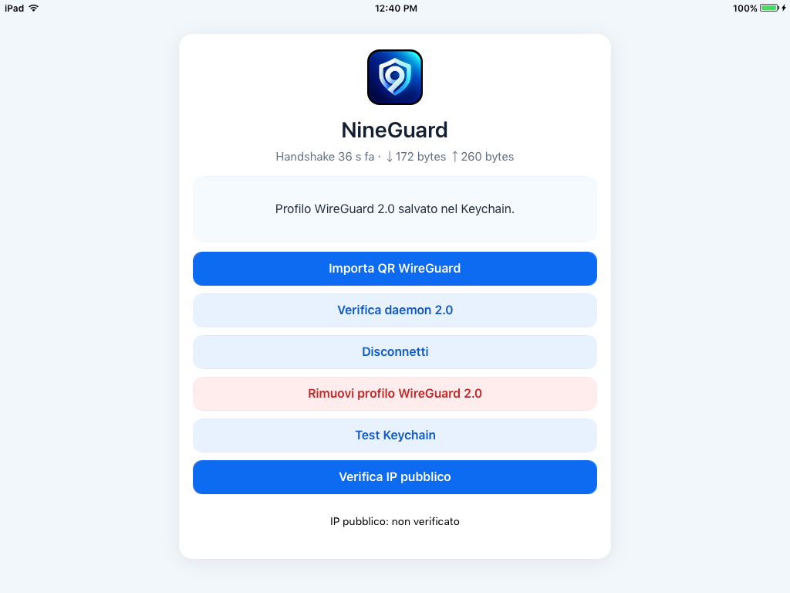

# NineGuard

Client WireGuard per iPad mini 1 (iOS 9.3.6, jailbreak), senza
NetworkExtension: app IPA + daemon root launchd + `wireguard-go` ARMv7
su `utun0`.



## Installazione rapida

1. Sull'iPad jailbroken: OpenSSH, AppSync Unified e IPA Installer Console
   da Cydia.
2. Dalla pagina [Releases](https://github.com/LukeLeFox/NineGuard/releases/latest)
   scarica il `.deb` del companion e l'IPA.
3. Installa prima il `.deb` (`dpkg -i`), poi l'IPA (`installipa`).
4. Apri NineGuard, importa il QR del profilo WireGuard e tocca Connetti.

Dettagli, requisiti, uso e risoluzione dei problemi:
**[GUIDA.md](GUIDA.md)** (italiano / English).

## Struttura

| Percorso | Contenuto |
| --- | --- |
| `main.m`, `NG*.m` | App (UI, import QR, Keychain, client IPC del daemon) |
| `DaemonPrototype/` | Daemon `nineguardd` (UAPI, route, DNS via configd, watchdog cambio rete), helper e test |
| `DaemonPackage/` | Pacchetto companion `.deb` (daemon + engine + launchd) |
| `Engine/` | Build riproducibile di `wireguard-go` (Go 1.14.15, ARMv7) |
| `TestPeer/` | `ngtestpeer`, peer WireGuard userspace per i test sul device |
| `Tunnel/`, `UtunProbe/` | Prototipi iniziali (NetworkExtension, probe utun) |

## Build

Richiede Theos in `~/theos` (target `iphone:clang:9.2:9.0`, `armv7`).

```bash
make engine                          # wireguard-go ARMv7
make clean && make -j2 stage         # app
make -C DaemonPrototype clean signed # daemon e helper
make -C DaemonPackage clean package  # companion .deb
DaemonPrototype/tests/host/run-host-tests.sh
```

## Documentazione

- `GUIDA.md` (italiano / English): come funziona, requisiti, compilazione,
  installazione, uso, disinstallazione, problemi comuni.
- `NINEGUARD-2-CONTINUATION.md`: stato, gate verificati, sessioni.
- `DaemonPrototype/FULL-TUNNEL-DNS-DESIGN.md`: full tunnel, DNS, watchdog
  cambio rete, MTU.
- `NINEGUARD-UTUN-HANDOFF.md`: storia del prototipo utun.
- `CLAUDE.md`: regole operative per le sessioni con Claude Code.

Profili, chiavi e configurazioni WireGuard non sono e non devono essere
versionati.

## Licenza

MIT, vedi `LICENSE`. `wireguard-go`, scaricato e compilato da
`Engine/build-wireguard-go.sh` e usato da `TestPeer/` e dai test host, è
distribuito con la propria licenza MIT (© WireGuard LLC).
